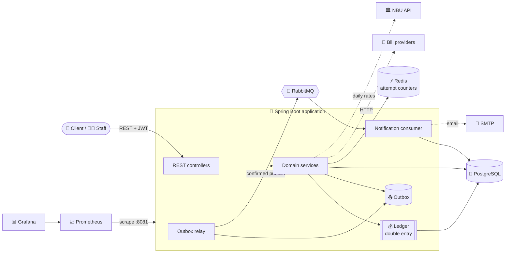

<div align="center">

# 🏦 Digital Banking Application

**The back-end of a mobile bank — where every kopiyka is accounted for, under any load.**

[](https://github.com/VitaliyProgrammer/digital-banking-application/actions/workflows/ci.yml)


</div>

---

## 📖 What it is

A digital bank in the spirit of Monobank, built as a **single Spring Boot application** with clear internal domains. Clients open accounts in UAH, USD and EUR, get cards, top up, send money to each other by IBAN or card number, pay utilities and mobile, exchange currency, save in interest-bearing jars, earn cashback, and take a credit line with a 62-day interest-free period. Bank employees review credit applications, set exchange rates and answer support tickets, and every one of their actions is audited.

What makes it more than CRUD is **what happens when things go wrong**: two requests at the same instant, a client pressing "Pay" twice, a provider that never answers, a message broker that is down, 30 clients emptying the same account at once. Each of these has a mechanism, a test that proves it, and a page below explaining it.

## ✨ Features

| | Area | What a client or employee can do |
|---|---|---|
| 👤 | **Identity** | Register, log in, refresh and log out; roles CLIENT, SUPPORT, ADMIN |
| 💰 | **Accounts & ledger** | Accounts in 3 currencies, statements with the balance after every operation |
| 🔁 | **Payments** | Top-ups, transfers by IBAN, card-to-card transfers, all idempotent |
| 🧾 | **Bills** | Utilities, internet and mobile through external providers, asynchronous and safe against timeouts |
| 💳 | **Cards** | Payroll, student, virtual and credit cards; PIN with a lock after 3 wrong attempts |
| 💱 | **Exchange** | Daily NBU rates, the bank's buy/sell rates, quotes that hold a price for 30 s |
| 📄 | **Receipts** | PDF receipts (downloaded or emailed) with a numbered stamp |
| 🫙 | **Savings** | Jars with daily interest accrual and a monthly payout |
| 🎁 | **Cashback** | By bill category, with a monthly cap, paid monthly |
| 🏛️ | **Credit** | Automatic scoring with manual review of the grey zone; credit line, statements, minimum payment, interest and late fees |
| 🔔 | **Notifications** | In-app notifications for every event, email for the important ones |
| 🎧 | **Support** | Tickets with a staff queue; employees see a client's accounts only for their own ticket |
| 🕵️ | **Audit** | Append-only log of every staff action, searchable by admins |

**61 REST endpoints**, documented with OpenAPI: <http://localhost:8080/swagger-ui.html>.

## 🏗️ Architecture



### 📁 Package by feature

The code is organised **by domain first**: everything about credit lives in `credit/`, everything about payments in `payment/`. Inside, every domain has the same layers, so finding a class is the same in every one of them:

```
io.github.vitaliyprogrammer.banking
├── account/          accounts, the double-entry ledger, IBANs
├── identity/         users, login, JWT and refresh tokens, roles
├── payment/          top-ups, transfers, card transfers, bill payments
│   └── service/impl/fee/      one fee policy per payment type
├── card/             cards, encrypted numbers, PINs
├── exchange/         NBU rates, the bank's rates, quotes
├── receipt/ · savings/ · cashback/
├── credit/           applications and scoring, the credit line, statements
├── notification/     the event consumer, in-app and email notifications
├── outbox/           the transactional outbox and its relay to RabbitMQ
├── support/ · audit/
└── common/           what every domain shares: configuration, error handling, security, retries, metrics

credit/                         (every domain looks like this; a layer it does not need is simply absent)
├── configuration/              @Configuration and @ConfigurationProperties
├── controller/                 REST endpoints
├── dto/request/  dto/response/ what goes over HTTP
├── entity/  entity/status/     JPA entities and their enums
├── event/                      messages this domain publishes
├── exception/                  its business errors
├── repository/                 Spring Data repositories: its own tables only
└── service/  service/impl/     interfaces, and their implementations
```

| Rule | Enforced by |
|---|---|
| Inside a domain: controller → service → repository, never backwards | [ArchUnit](src/test/java/io/github/vitaliyprogrammer/banking/ArchitectureTests.java) `layersDependOnlyDownwards` |
| A domain's tables are used only by that domain's services | one ownership rule per repository |
| Domains meet only at service interfaces and DTOs, never at each other's `service/impl` | `domainsDoNotReachIntoEachOthersImplementation` |
| Dependencies between domains go one way, with no cycles | `domainsDependOnEachOtherWithoutCycles` |

Every domain uses only domains on a **lower** level, never one on its own level or above:

| Level | Domains | Uses |
|---|---|---|
| 6 | 🔔 `notification` | the events of everyone below; nobody depends on it |
| 5 | 🏛️ `credit` · 🫙 `savings` · 🎁 `cashback` · 📄 `receipt` | payments, and what payments use |
| 4 | 🔁 `payment` | the ledger, cards, exchange quotes, the outbox |
| 3 | 💱 `exchange` · 🎧 `support` | the ledger, identity, the audit log |
| 2 | 💳 `card` · 🕵️ `audit` | the ledger / identity |
| 1 | 💰 `account` · 👤 `identity` · 📤 `outbox` | only `common` |
| 0 | 🧰 `common` | no domain at all |

## 🚀 Quick start

> Requirements: **Docker**. For development from the IDE also **JDK 25**.

```bash
# 🐳 The whole bank in containers: app, PostgreSQL, Redis, RabbitMQ, Mailpit, Prometheus, Grafana
docker compose --profile app up -d --build
```

| What | Where |
|---|---|
| 📚 API (Swagger UI) | <http://localhost:8080/swagger-ui.html> |
| 📊 Grafana dashboard | <http://localhost:3000> (no login) |
| 📈 Prometheus | <http://localhost:9090> |
| 📧 Emails the bank sent | <http://localhost:8025> (Mailpit) |
| 🐇 RabbitMQ | <http://localhost:15672> (guest / guest) |

```bash
# 💻 Development: infrastructure in Docker, the application from the IDE or Maven
docker compose up -d
./mvnw spring-boot:run

# 🧪 Tests: unit + integration on real PostgreSQL, Redis and RabbitMQ (Testcontainers)
./mvnw verify

# 🔥 Load tests with k6 (the bank must be running with --profile app)
docker compose --profile load run --rm k6 run /scripts/load.js
```

The first admin is created at startup from `ADMIN_EMAIL` and `ADMIN_PASSWORD` (for example in a local `.env` file); there is no default admin.

## 📚 Documentation

| | Document | What you will find |
|---|---|---|
| 💰 | [**Ledger**](docs/ledger.md) | Double-entry bookkeeping, an append-only journal, balances as a projection, reconciliation, sharded hot accounts |
| 🔁 | [**Payments**](docs/payments.md) | Idempotency keys, row locks and deadlock-free ordering, bill payments through a hold, fees, currency exchange |
| 🏛️ | [**Credit**](docs/credit.md) | Scoring rules, manual review, the credit line, the 62-day grace period, statements, interest and late fees |
| 📨 | [**Events & notifications**](docs/events.md) | Transactional outbox, RabbitMQ with publisher confirms, idempotent consumer, dead-letter queue |
| 🛡️ | [**Security**](docs/security.md) | JWT with refresh-token rotation, roles, four-eyes rule, least privilege, audit log, card data protection |
| 🧪 | [**Testing**](docs/testing.md) | Testcontainers, one shared context, ArchUnit rules, what each test proves |
| 📈 | [**Operations**](docs/operations.md) | Docker image, configuration, metrics, the Grafana dashboard |
| 🔥 | [**Load tests**](load-tests/README.md) | k6 scenarios, results, and the bottleneck they found |

## 🧰 Tech stack

| Layer | Technology |
|---|---|
| Language & framework | Java 25 (virtual threads), Spring Boot 4.1, Spring Security (OAuth2 resource server), Spring Data JPA, Hibernate 7 |
| Data | PostgreSQL 17, Flyway (22 migrations), Redis 8 |
| Messaging | RabbitMQ 4.1, Spring AMQP |
| Documents & mail | PDFBox, Jakarta Mail (Mailpit locally) |
| Observability | Micrometer, Prometheus, Grafana |
| Testing | JUnit 5, AssertJ, Testcontainers, WireMock, ArchUnit, k6 |
| Build & delivery | Maven, multi-stage Docker image, Docker Compose, GitHub Actions |

## 🐳 Try it on your computer

[](https://github.com/VitaliyProgrammer/digital-banking-application/pkgs/container/digital-banking-application)
-lightgrey)

All it needs is [**Docker**](https://www.docker.com/products/docker-desktop/).

The bank comes as a ready image, [`ghcr.io/vitaliyprogrammer/digital-banking-application`](https://github.com/VitaliyProgrammer/digital-banking-application/pkgs/container/digital-banking-application). Nothing to build, no Java to install:

```bash
# 📥 Cloned the repository? From its folder:
docker compose -f docker-compose.demo.yml up -d

# 🍎 macOS / 🐧 Linux / Git Bash, without cloning:
curl -O https://raw.githubusercontent.com/VitaliyProgrammer/digital-banking-application/main/docker-compose.demo.yml
docker compose -f docker-compose.demo.yml up -d

# 🪟 Windows PowerShell, without cloning (plain "curl" there is another command):
curl.exe -O https://raw.githubusercontent.com/VitaliyProgrammer/digital-banking-application/main/docker-compose.demo.yml
docker compose -f docker-compose.demo.yml up -d
```

About a minute later:

| | |
|---|---|
| 📚 API, try every endpoint in the browser | <http://localhost:8080/swagger-ui.html> |
| 📧 Emails the bank sends (receipts, notifications) | <http://localhost:8025> |
| 🧑‍💼 Demo admin (credit queue, rates, audit) | `admin@bank.local` / `demo-admin-password` |
| 🛑 Stop | `docker compose -f docker-compose.demo.yml down` |

**A first tour in Swagger:** `POST /authentication/register` → `POST /authentication/login` → press **Authorize** and paste the `accessToken` → `POST /accounts` (`{"currency": "UAH"}`) → `POST /payments/top-up` → `GET /accounts/{id}/transactions`.

## 🧭 How it was built

Every feature went through its own branch and pull request with a green CI: **more than 25 pull requests**, Conventional Commits, small commits that each compile. Design decisions are explained in the code where they are made, and in the documents above.

<div align="center">

**Made by [Vitaliy](https://github.com/VitaliyProgrammer)** · Java back-end developer

</div>
