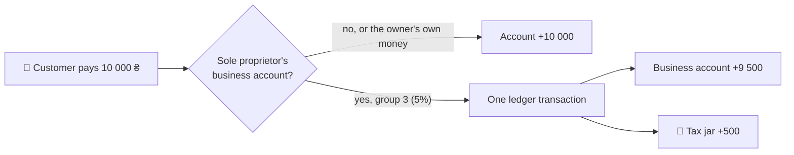

# 💼 Sole proprietors (ФОП)

A client registers as a sole proprietor (фізична особа-підприємець) and gets a business account apart from their own money, a **BUSINESS** card, and a **tax jar**. Group 3 income is taxed the moment it arrives.

[⬅️ Back to README](../README.md)

## 📝 Opening

`POST /business` with what the client registered with:

| Field | Rule |
|---|---|
| `name` | as registered, e.g. "ФОП Іваненко Олена" |
| `taxId` | РНОКПП, 10 digits; one sole proprietor per tax number in the bank |
| `kvedCodes` | КВЕД codes such as `62.01`, the main one first, up to 10 |
| `taxGroup` | `GROUP_1`, `GROUP_2` or `GROUP_3` |
| `vatPayer` | only for group 3, as the Tax Code says (checked in Java and by a `CHECK` in the database) |
| `registeredOn` | not in the future |

One transaction opens everything: the profile, a `BUSINESS` account in UAH, a `TAX_RESERVE` account (the tax jar) and a `BUSINESS` card. A profile without its accounts cannot exist.

## 💸 Income and its tax

| Decision | Why |
|---|---|
| 🔹 Income is money from outside the bank or from **another** client | the owner moving their own money from a personal account to the business account earns nothing, so it is not taxed |
| 🔹 The tax goes aside **in the same ledger transaction** as the income | it can never be spent first, and a crash cannot leave the income in without its tax |
| 🔹 Group 3: 5%, or 3% for a VAT payer | a share of every income |
| 🔹 Groups 1 and 2: a fixed tax every month, nothing put aside | the amount does not depend on income; it is shown as three months for the quarter |
| 🔹 The fixed amounts live in `application.yml` | they follow the subsistence minimum and the minimum wage, which change every January |
| 🔹 Every income is a row in `business_incomes` | the quarter's income and tax are sums of these rows, also for groups 1 and 2 (the income limits of those groups need them) |

## 🔒 What the tax jar may not do

| | |
|---|---|
| 💳 Card | no card can be issued on it |
| ➡️ Transfer | it is not a current account, so no transfer, bill or exchange can take money out of it |
| 🪪 Cards and accounts | a `BUSINESS` card goes only on the business account, every other card only on a personal account |

## 🧪 Proof

`BusinessIntegrationTests`: opening gives all three; only group 3 may pay VAT; 5% and 3% go into the jar; the owner's own money is not income; groups 1 and 2 put nothing aside but still count income; the jar cannot be spent and cards stay on their kind of account.
