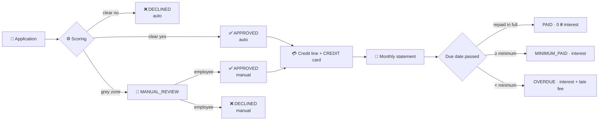

# 🏛️ Credit

> **In one sentence:** the rules decide the clear cases at once, a person decides the grey zone, and an approved limit becomes a credit line with up to 62 interest-free days, monthly statements, a minimum payment, interest and late fees.

← [Back to README](../README.md) · built on the [💰 Ledger](ledger.md) and [🔁 Payments](payments.md)

---

## 🧭 The whole path

## ⚙️ Scoring: a pure function

[`CreditScoring`](../src/main/java/io/github/vitaliyprogrammer/banking/credit/service/impl/CreditScoring.java) gets three facts and returns a decision with **reasons in plain words**. No database, no clock: every rule and every border is a millisecond unit test ([`CreditScoringTests`](../src/test/java/io/github/vitaliyprogrammer/banking/credit/CreditScoringTests.java)).

| Fact | Where it comes from |
|---|---|
| Age of the UAH current account | the account itself |
| Income over the last 90 days | the **ledger**: top-ups and transfers from **other** people. Moving one's own money (savings → account, exchange, own card) is left out, so a client cannot raise their limit by shuffling the same 1 000 ₴ back and forth |
| Requested limit | the application |

| Rule (all numbers in `banking.credit`) | Outcome |
|---|---|
| Account younger than 30 days, or income under 15 000 ₴ in 90 days | ❌ declined, whatever was asked |
| **Affordable limit** = 50% of the average monthly income, in whole hundreds, at most 100 000 ₴ | |
| Requested ≤ affordable **and** ≤ 10 000 ₴ | ✅ approved automatically |
| Requested ≤ 1.5 × affordable | 👀 a person decides |
| More | ❌ declined |

## 👀 The grey zone: people, with rules

`GET /admin/credit-applications` is the queue for **SUPPORT** and **ADMIN**. A decision (`/approve` with a limit, or `/decline`) always needs a comment.

| Rule | How |
|---|---|
| 🔒 Decided once | the application row is locked; a second reviewer waits, then gets **409** instead of overwriting the first decision |
| 👥 Four-eyes | nobody decides on their own application (**403**), even an employee who is also a client |
| 📏 Within bounds | an approved limit never exceeds the bank's maximum |
| 🕵️ Accountable | every manual decision is in the [audit log](security.md#-audit-log): who, from which state to which, the limit, the comment |
| 🔔 Announced | the client gets a notification and an email ([events](events.md)) |

## 💳 The credit line

Approval opens the line **in the same transaction**: a `CREDIT` account in UAH with the approved limit, and a `CREDIT` card on it. "Approved, but no account" cannot happen.

| | |
|---|---|
| 💸 Spend | card-to-card transfers (2% fee) and bill payments |
| 🚫 Not allowed | moving borrowed money into savings, exchanging it, sending it by IBAN: no earning 12% on the bank's money |
| 🔒 Limit | checked in `Account.apply()` under the row lock: 10 parallel payments against an 8 000 ₴ limit → exactly 7 go through |
| 💵 Repay | `POST /credit-line/repayments` from the UAH current account, free, never more than the debt |
| ➕ Positive balance | allowed: a refund or cashback after repayment is the client's own money, spent first |

## 📅 Up to 62 days without interest

Everything spent in a month forms that month's statement. It closes at **midnight on the 1st (Kyiv time)** and is interest-free until the **end of the next month**:

| Spent on | Statement closes | Interest-free until | Days |
|---|---|---|---|
| 1 December | 1 January 00:00 | 31 January | **62** (the longest) |
| 31 October | 1 November 00:00 | 30 November | 31 |
| 15 January 2028 | 1 February 00:00 | 29 February (leap year) | 46 |

The calendar arithmetic is a pure class, [`GracePeriod`](../src/main/java/io/github/vitaliyprogrammer/banking/credit/service/impl/GracePeriod.java), with tests for the 62-day case, February, leap years and Kyiv-vs-UTC midnight.

## 🧮 Statements, minimum payment, interest

A job runs on the **1st of every month at 02:00 Kyiv time**. It is safe to run twice or on two instances: a month gets one statement (`ON CONFLICT DO NOTHING`), and a statement is settled once under a row lock.

1. **Settle** every statement whose due date has passed, counting only repayments made between its closing and its due date. These windows never overlap, so one repayment never counts twice.
2. **Close** last month: the debt at midnight becomes a statement with a minimum payment.

| Outcome | When | Charged |
|---|---|---|
| ✅ `PAID` | repaid in full by the due date | nothing |
| 🟡 `MINIMUM_PAID` | at least the minimum: 5% of the statement, at least 100 ₴, never more than the debt | **2.5%** of what is still unpaid |
| 🔴 `OVERDUE` | less than the minimum | 2.5% interest **+ 100 ₴** late fee |

Charges are one ledger transaction: credit line → `INTEREST_INCOME` (+ `FEE_INCOME`). They **may take a used-up line past its limit** (overlimit), because interest has to be charged anyway. Spending still stops at the limit, and a repayment into an overlimit line always works.

Proved in [`CreditStatementIntegrationTests`](../src/test/java/io/github/vitaliyprogrammer/banking/credit/CreditStatementIntegrationTests.java): a statement is closed once, interest is charged once even if the job runs twice, and an overdue line ends at 8 254.90 ₴ debt on an 8 000 ₴ limit, yet refuses to spend another 1 ₴.

## 🗂️ Where in the code

| What | File |
|---|---|
| Applications, staff decisions | [`CreditApplicationServiceImpl`](../src/main/java/io/github/vitaliyprogrammer/banking/credit/service/impl/CreditApplicationServiceImpl.java) |
| Scoring rules | [`CreditScoring`](../src/main/java/io/github/vitaliyprogrammer/banking/credit/service/impl/CreditScoring.java) |
| Credit line, statements, the monthly job | [`CreditLineServiceImpl`](../src/main/java/io/github/vitaliyprogrammer/banking/credit/service/impl/CreditLineServiceImpl.java), [`CreditLineScheduler`](../src/main/java/io/github/vitaliyprogrammer/banking/credit/service/impl/CreditLineScheduler.java) |
| Minimum payment and settlement rules | [`CreditTerms`](../src/main/java/io/github/vitaliyprogrammer/banking/credit/service/impl/CreditTerms.java) |
| Tests | [`credit/`](../src/test/java/io/github/vitaliyprogrammer/banking/credit) |
