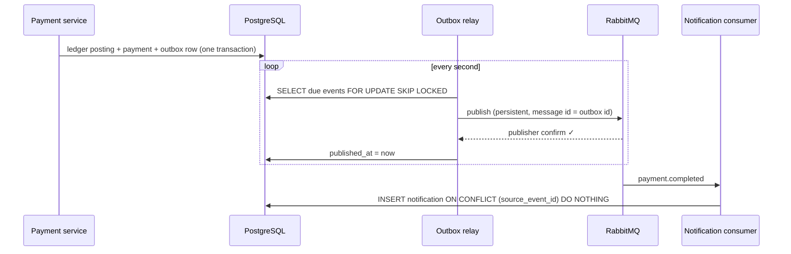
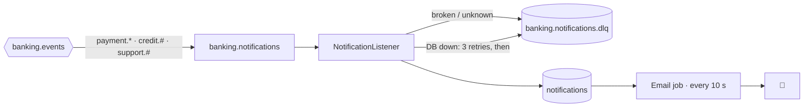

# 📨 Events & notifications

> **In one sentence:** an event is written in the same transaction as the money, a relay hands it to RabbitMQ, and the consumer turns it into a notification exactly once, however many times the message arrives.

← [Back to README](../README.md)

---

## ❓ Why not just `rabbitTemplate.send()`?

| Where the send happens | What can go wrong |
|---|---|
| Before the commit | the message is out, then the transaction rolls back: the client is told about a payment **that does not exist** |
| After the commit | the transaction commits, then the broker is down or the process dies: the notification is **lost forever** |

The **transactional outbox** removes both: the event goes into a table in the **same** transaction as the business change, and is published afterwards.

## 📤 The outbox and its relay

| Decision | Why |
|---|---|
| 🔹 `OutboxService.record()` is `Propagation.MANDATORY` | an event in a transaction of its own would commit even if the payment rolled back; called outside a transaction it fails at once |
| 🔹 `FOR UPDATE SKIP LOCKED` | two relay instances take **different** batches instead of waiting for each other or publishing the same events |
| 🔹 Publisher confirm **before** marking published | the row is marked only once the broker said "ack"; messages are persistent and survive a broker restart |
| 🔹 The first failure ends the batch, then backoff 2 s → 4 s → … ≤ 5 min | the broker is most likely down; there is no point waiting for a timeout 50 times or hammering it every second |
| 🔹 The RabbitMQ health check is off | the broker being down must not mark the whole bank as DOWN: payments go on, events wait in the outbox |
| 🔹 ArchUnit: only `OutboxRelay` may use `RabbitTemplate` | a direct send next to a database change is exactly the bug this pattern prevents, so it fails the build |

**Delivery is at least once, never exactly once.** If the process dies after the broker's confirm but before the commit, the event is published again. That is why the consumer must deduplicate, and why the message id is the outbox row id.

### Events

| Routing key | When | Body |
|---|---|---|
| `payment.completed` | any payment reached COMPLETED | `PaymentMessage` |
| `payment.failed` | a bill payment was rejected or never reached the provider; the money came back | `PaymentMessage` |
| `credit.application.decided` | approved or declined, by the rules or by a person | `CreditDecisionMessage` |
| `credit.statement.settled` | a statement after its due date: PAID, MINIMUM_PAID, OVERDUE | `CreditStatementMessage` |
| `support.ticket.replied` / `support.ticket.resolved` | support answered or closed a ticket | `SupportTicketMessage` |

The exchange `banking.events` is a **topic** exchange: a consumer binds to exactly what it needs (`payment.*`, `credit.#`). A message body is a contract: fields may be added, never renamed or removed, and it carries no account numbers or card data.

## 📥 The notification consumer

| Decision | Why |
|---|---|
| 🔹 Its own queue and bindings | the publisher knows nothing about consumers: a new consumer is a new queue, not a change in payments |
| 🔹 `source_event_id UNIQUE` + `ON CONFLICT DO NOTHING` | the same event twice makes **one** notification, with no separate "processed messages" table |
| 🔹 A broken or unknown message goes straight to the **DLQ** | a poison message is never retried forever and never blocks the others; it waits for a person |
| 🔹 The email is **not** sent by the consumer | a mail server that is down would push the message into retries and the DLQ, and the email would be lost. Instead the notification gets `email_status = PENDING`, and its own job sends it (`SKIP LOCKED`, backoff, 6 attempts, then `FAILED`) |
| 🔹 Email only when it matters | a failed payment, a credit decision, interest or a late fee, a support answer. Everyday payments stay in the app |

The client sees it all under the bell: `GET /notifications`, `GET /notifications/unread-count`, `POST /notifications/{id}/read`, `POST /notifications/read-all`.

## 📊 Watching it

| Metric | Means |
|---|---|
| `bank_outbox_unpublished` | events written but not confirmed by the broker; it grows when RabbitMQ is down |
| `bank_outbox_oldest_unpublished_age_seconds` | how long the oldest one has waited |
| `bank_notifications_emails_pending` | grows when the mail server is down |
| `bank_notifications_dead_letters` | above zero: a person has to look |

All four are on the [Grafana dashboard](operations.md#-metrics-and-the-dashboard) with green / yellow / red thresholds.

## 🗂️ Where in the code

| What | File |
|---|---|
| Writing an event | [`OutboxServiceImpl`](../src/main/java/io/github/vitaliyprogrammer/banking/service/impl/OutboxServiceImpl.java) |
| Publishing | [`OutboxRelay`](../src/main/java/io/github/vitaliyprogrammer/banking/service/impl/OutboxRelay.java), [`OutboxBackoff`](../src/main/java/io/github/vitaliyprogrammer/banking/service/impl/OutboxBackoff.java) |
| Consuming | [`NotificationListener`](../src/main/java/io/github/vitaliyprogrammer/banking/service/impl/NotificationListener.java), [`NotificationServiceImpl`](../src/main/java/io/github/vitaliyprogrammer/banking/service/impl/NotificationServiceImpl.java) |
| Texts and the "worth an email" rule | [`NotificationComposer`](../src/main/java/io/github/vitaliyprogrammer/banking/service/impl/NotificationComposer.java) |
| Tests | [`outbox/`](../src/test/java/io/github/vitaliyprogrammer/banking/outbox), [`notification/`](../src/test/java/io/github/vitaliyprogrammer/banking/notification) |
