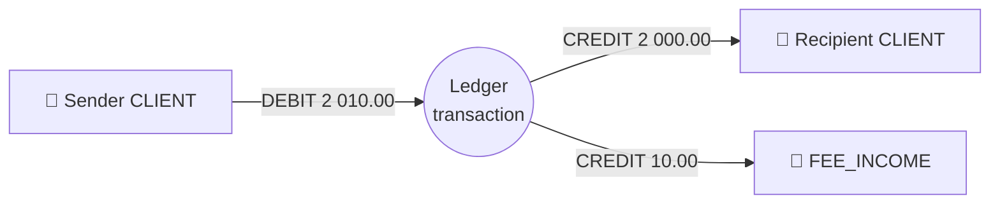
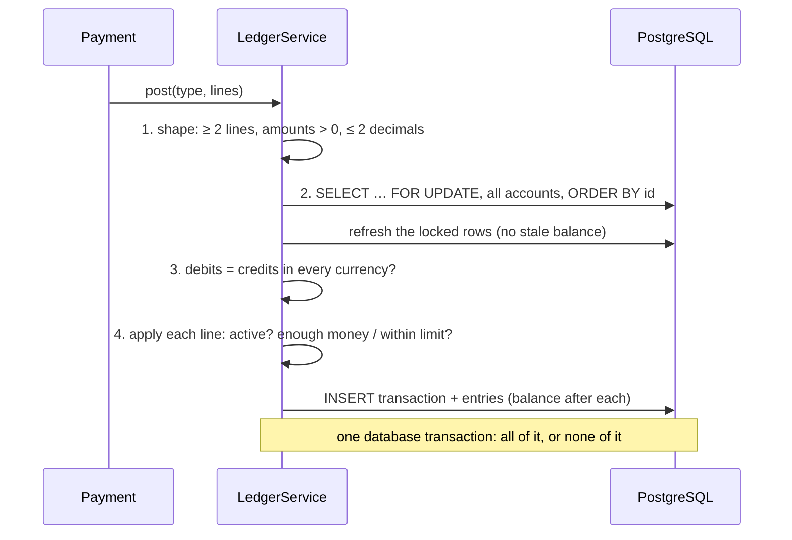

# 💰 Ledger

> **In one sentence:** money never "changes"; it only **moves** between accounts, every movement is written down for good, and the books always add up to zero.

← [Back to README](../README.md)

---

## 🧠 The idea

A naive bank stores a balance and does `balance = balance - 100`. If that line runs twice, or crashes halfway, nobody can tell what happened. A real ledger does the opposite:

| Naive balance | Double-entry ledger |
|---|---|
| One number per account, overwritten | A journal of movements; the balance is derived from it |
| "Why is it 340?" — nobody knows | Every kopiyka has a line: when, from where, why |
| A bug can create or lose money silently | Debits and credits must match, or nothing is saved |
| History can be edited | History can only be **added** to |

## 📒 Accounts

Every movement has two sides, so the bank needs accounts for "the outside world" too:

| Type | Owner | Balance | Role |
|---|---|---|---|
| `CLIENT` | client | ≥ 0 | a current account in UAH, USD or EUR |
| `SAVINGS` | client | ≥ 0 | a savings jar; money leaves it only back to the client |
| `CREDIT` | client | ≥ −limit | a credit line; a negative balance is the debt |
| `SETTLEMENT` | bank | any | the mirror of the outside world: money entering the bank is debited here |
| `FEE_INCOME` | bank | any | fees charged to clients |
| `HOLD` | bank | any | money reserved for a bill payment until the provider answers |
| `FX_POSITION` | bank | any | the bank's side of currency exchanges |
| `INTEREST_EXPENSE` / `CASHBACK_EXPENSE` | bank | any | what the bank pays out: savings interest, cashback |
| `INTEREST_INCOME` | bank | any | interest charged on credit lines |

Because settlement accounts go negative exactly as much as clients go positive, **the sum of all balances in a currency is always zero**.

## ✍️ A posting

Every money movement is one **ledger transaction** with two or more **entries**. A transfer of 2 000 ₴ with a 10 ₴ fee:

| Entry | Account | Direction | Amount | Balance after |
|---|---|---|---|---|
| 1 | sender | DEBIT | 2 010.00 | 990.00 |
| 2 | recipient | CREDIT | 2 000.00 | 2 000.00 |
| 3 | fee income | CREDIT | 10.00 | … |

Debits 2 010.00 = credits 2 010.00. **One transaction, three lines: they are saved together or not at all.**

## 🔒 How `LedgerService.post()` works

| Step | Why |
|---|---|
| 🔹 Lock **all** accounts in **one** query, **ordered by id** | Two transfers A→B and B→A lock A and B in the same order, so they cannot deadlock |
| 🔹 Re-read the rows after locking | Hibernate keeps entities it already loaded; without a refresh, parallel payments would lose updates |
| 🔹 Check the balance in the entity, under the lock | Two payments from one account can never both pass the check: the second one waits and sees the new balance |
| 🔹 Store `balance_after` on every entry | The balance at any past moment is one indexed read (used by savings interest and credit statements) |

Only `LedgerServiceImpl` may change a balance. That is not a convention but an [ArchUnit rule](../src/test/java/io/github/vitaliyprogrammer/banking/ArchitectureTests.java) (`onlyTheLedgerChangesBalances`): any other class calling `Account.apply()` fails the build.

## 🧱 Defence in depth

| Layer | What it stops |
|---|---|
| Java: `Account.apply()` | spending more than the balance or the credit limit, an inactive account |
| PostgreSQL `CHECK` | a client balance below zero, whatever the Java code does |
| PostgreSQL trigger `forbid_ledger_change` | **any** `UPDATE` or `DELETE` on the journal, even from a manual SQL session |
| Reconciliation after every integration test | a cached balance that differs from the sum of its entries; money created or lost in any currency |

A mistake is corrected the way accountants do it: with a new, compensating transaction, never by editing the old one.

## 🔥 Hot accounts and shards

Every transfer with a fee touches the bank's fee income account. With **one** such row, all parallel transfers queue behind its lock, however different their own accounts are. The k6 load test found exactly that ([results](../load-tests/README.md)).

The fix used by real ledgers ([`V22`](../src/main/resources/db/migration/V22__shard_hot_bank_accounts.sql)): the hot bank accounts (`FEE_INCOME`, `SETTLEMENT`, `HOLD`) exist as **16 shards** per currency, and each posting takes a random one. The bank's fee income is the sum of its shards; every posting is still balanced, so nothing else changes. Transfer p95 under load: **890 → 483 ms**.

## 🗂️ Where in the code

| What | File |
|---|---|
| Posting, locking, balancing | [`LedgerServiceImpl`](../src/main/java/io/github/vitaliyprogrammer/banking/service/impl/LedgerServiceImpl.java) |
| Balance rules per account type | [`Account`](../src/main/java/io/github/vitaliyprogrammer/banking/entity/Account.java) |
| Tables, checks, append-only trigger | [`V3`](../src/main/resources/db/migration/V3__create_accounts.sql), [`V4`](../src/main/resources/db/migration/V4__create_ledger.sql) |
| Reconciliation after every test | [`IntegrationTest`](../src/test/java/io/github/vitaliyprogrammer/banking/IntegrationTest.java) |
| Parallel debits never overdraw, opposite transfers never deadlock, history cannot be changed | [`LedgerConcurrencyIntegrationTests`](../src/test/java/io/github/vitaliyprogrammer/banking/account/LedgerConcurrencyIntegrationTests.java) |
