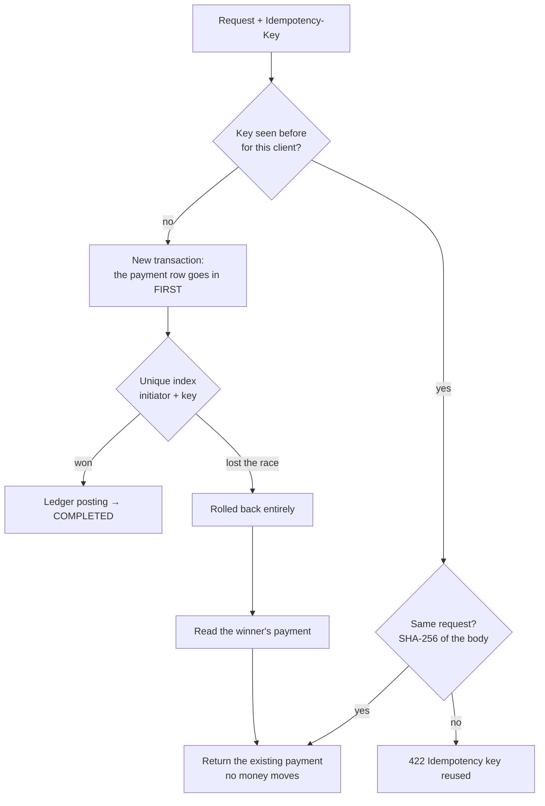
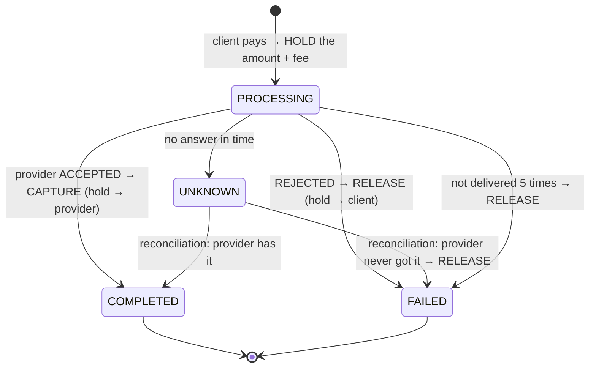
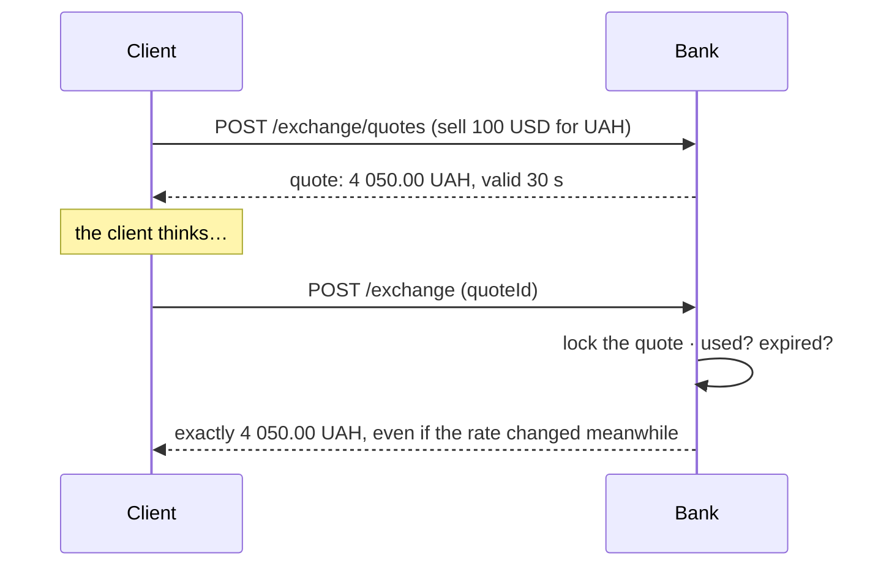

# 🔁 Payments

> **In one sentence:** pressing "Pay" twice pays once, two payments at the same instant never overspend, and a provider that goes silent never loses the client's money.

← [Back to README](../README.md) · built on the [💰 Ledger](ledger.md)

---

## 🧾 Payment types

| Type | Endpoint | Money moves | Fee |
|---|---|---|---|
| 💵 Top-up | `POST /payments/top-up` | settlement → client | free |
| ➡️ Transfer by IBAN | `POST /payments/transfers` | client → client | 0.5%, at least 5.00 ₴ |
| 💳 Card to card | `POST /payments/card-transfers` | the sender card's account → the recipient card's account | by card type: student 0%, payroll 0.5%, virtual 1%, credit 2% |
| 🧾 Bill | `POST /bill-payments` | client → hold → provider (asynchronous) | utilities and internet 0.5%, mobile 1%, at least 1.00 ₴ |
| 💱 Exchange | `POST /exchange` | client (currency A) → FX position → client (currency B) | none: the bank earns on its buy/sell spread |
| 🫙 Savings | `POST /savings/{id}/deposits`, `…/withdrawals` | current ↔ savings of the same client | free |
| 🏛️ Credit repayment | `POST /credit-line/repayments` | current → credit line | free |

Every fee is a separate `FeePolicy` per payment type. The application **refuses to start** if a type has no policy, so a new payment type can never go out free by accident.

## 🔑 Idempotency: one click, one payment

Mobile networks drop answers. The client's app does not know whether the payment went through, so it sends it again. Every payment request carries an `Idempotency-Key` header (a new UUID per operation):

| Case | What happens | Proved by |
|---|---|---|
| Same key, same request | the original payment is returned, nothing moves | `parallelRequestsWithSameKeyCreateOnePayment` |
| Same key, different request | 422: a key belongs to one operation | `sameKeyWithDifferentRequestIsRejected` |
| Two identical requests at the same instant | the unique index lets one in; the other is rolled back and returns the winner | k6 [`contention.js`](../load-tests/contention.js): 100% of retries got the same payment |

The payment row is the **first** write of the transaction, so a parallel duplicate stops at the unique index **before** any money moves.

## 🏁 Races: two payments, one balance

Thirty payments from one account at the same moment must not each "see" the same balance. The [ledger](ledger.md#-how-ledgerservicepost-works) locks the accounts with `SELECT … FOR UPDATE` in the order of their ids and checks the balance **under the lock**: the second payment waits, then sees what the first one left.

Under load ([k6 contention](../load-tests/README.md)): 30 users on one account of 15 000 ₴, transfers of 10 ₴ + 5 ₴ fee → exactly **1 000** went through, every next one got `422 Insufficient funds`, and the balance ended at **0.00**.

## 🧾 Bill payments: the provider is outside the transaction

A provider is a remote HTTP service that can be slow, reject, or not answer at all. Calling it inside a database transaction would hold row locks for seconds and still not know the outcome. So the work is split:

| Step | Where | Why |
|---|---|---|
| 1. Hold | the request's transaction | the money leaves the balance at once, so it cannot be spent twice; nothing has left the bank yet |
| 2. Claim | a short transaction with a lease | several workers never send the same payment: `FOR UPDATE SKIP LOCKED` + lease time |
| 3. Call the provider | **no** transaction | a slow provider holds no locks and no connections |
| 4. Apply the answer | a new transaction, row locked | a final state is written exactly once |
| 5. Reconcile `UNKNOWN` | later, by asking the provider by reference | "no answer" is not "failed": the provider may have the money |

The provider receives the payment id as its reference, so asking again is safe on both sides. Proved against a real HTTP server (WireMock) that can be slow, refuse or accept: `acceptedPaymentIsSentOnceEvenWithFiveWorkers`, `timeoutBecomesUnknownAndReconciliationFinishesTheJob`, `unknownPaymentThatTheProviderNeverGotIsReturned`.

## 💱 Currency exchange: a price that holds

- Rates come from the **NBU** once a day; the bank's buy/sell rates are a spread around them (or set manually by an admin, within ±10% of the official rate).
- A quote is spent **once**, even by five parallel requests with different keys (the quote row is locked; a unique index is the last line of defence).
- USD → EUR goes through UAH. Intermediate values keep 8 decimals, and only the final amount is rounded, **once**, in the bank's favour.

## 🗂️ Where in the code

| What | File |
|---|---|
| All payment types, idempotency | [`PaymentServiceImpl`](../src/main/java/io/github/vitaliyprogrammer/banking/payment/service/impl/PaymentServiceImpl.java) |
| Bill worker and reconciliation | [`BillPaymentProcessor`](../src/main/java/io/github/vitaliyprogrammer/banking/payment/service/impl/BillPaymentProcessor.java) |
| Fee policies | [`FeeCalculator`](../src/main/java/io/github/vitaliyprogrammer/banking/payment/service/impl/fee/FeeCalculator.java) and `*FeePolicy` next to it |
| Quotes and rates | [`ExchangeQuoteServiceImpl`](../src/main/java/io/github/vitaliyprogrammer/banking/exchange/service/impl/ExchangeQuoteServiceImpl.java), [`ExchangeRateServiceImpl`](../src/main/java/io/github/vitaliyprogrammer/banking/exchange/service/impl/ExchangeRateServiceImpl.java) |
| Tests | [`payment/`](../src/test/java/io/github/vitaliyprogrammer/banking/payment), [`exchange/`](../src/test/java/io/github/vitaliyprogrammer/banking/exchange) |
