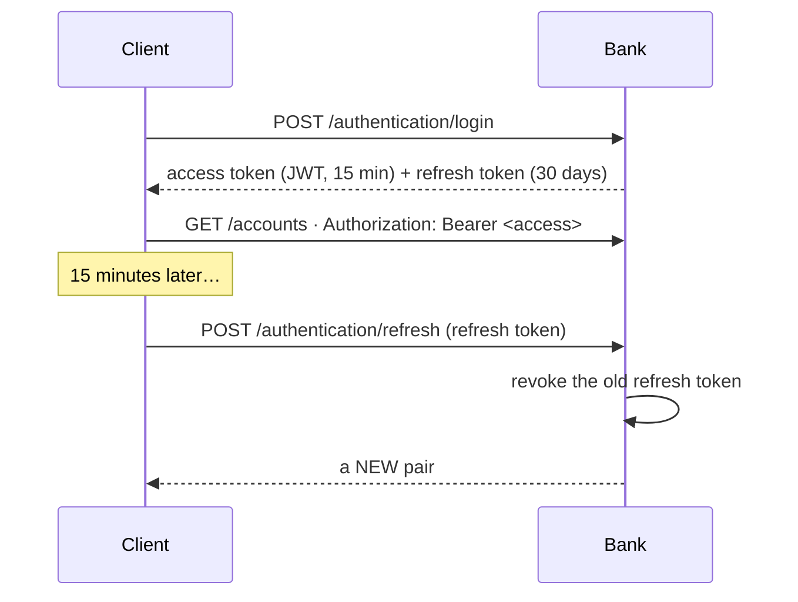

# 🛡️ Security

> **In one sentence:** short-lived tokens, refresh tokens that detect theft, roles with the least privilege needed, nobody deciding on their own case, every staff action in a log that cannot be edited, and card secrets that are never stored in plain text.

← [Back to README](../README.md)

---

## 🔐 Authentication

| Decision | Why |
|---|---|
| 🔹 Stateless API, JWT signed with HS256 | no session, no cookies, so no CSRF to defend; any instance can check a token |
| 🔹 Short access token (15 min) | a stolen access token is useful only briefly |
| 🔹 **Refresh token rotation** | every refresh revokes the old token and issues a new pair |
| 🔹 **Reuse detection** | a refresh token that was already used means it was stolen or replayed, so **all** sessions of that user are revoked at once |
| 🔹 Refresh tokens stored as SHA-256 | 256 random bits leave nothing to brute-force, and a fast hash keeps the lookup an indexed equality |
| 🔹 Passwords with BCrypt | slow on purpose: a stolen table cannot be cracked quickly |
| 🔹 Identical answer for "unknown email" and "wrong password" | the login does not reveal who has an account |
| 🔹 5 failed logins per 15 min, then 429 | an atomic Redis counter with a TTL; it holds even across several instances |
| 🔹 No default admin | the first admin comes from `ADMIN_EMAIL` / `ADMIN_PASSWORD`; staff roles are never self-assigned |

## 👥 Roles and rules

| Rule | Where | Why |
|---|---|---|
| Everything needs a token except login, registration, public rates and docs | `SecurityConfiguration` | deny by default |
| `/admin/credit-applications/**`, `/admin/support/**` → SUPPORT or ADMIN | `SecurityConfiguration` | the narrower rule comes first: the first match wins |
| Everything else under `/admin/**` → ADMIN | `SecurityConfiguration` | rates, the audit log |
| Someone else's account, card, payment, ticket → **404**, not 403 | ownership is part of every query | the existence of other people's data is not revealed |
| 👥 **Four-eyes**: nobody decides on their own credit application or handles their own ticket | the service under a row lock; for tickets also a database CHECK | an employee can also be a client |
| 🔒 **Least privilege**: support sees a client's accounts **only** for a ticket they took, read-only | `SupportTicketServiceImpl.getClientView` | there is no "show me anyone's money" screen |

## 🕵️ Audit log

Every action of an employee that changes something **or looks at a client's money** is written to `audit_log`, in the **same transaction** as the action:

| Action | Details stored |
|---|---|
| `CREDIT_APPLICATION_APPROVED` / `DECLINED` | from → to state, requested and approved limit, comment |
| `BANK_RATE_SET` | currency, mode, buy / sell, spread, comment |
| `TICKET_TAKEN` / `ANSWERED` / `RESOLVED` | state change, message id |
| `CLIENT_ACCOUNTS_VIEWED` | which ticket the view was made for |

| Property | How |
|---|---|
| An entry exists **if and only if** the action happened | `Propagation.MANDATORY`: a refused action (e.g. 409 "already decided") leaves no entry |
| The role is the one **at that moment** | a later promotion does not rewrite the past |
| Cannot be changed, even with plain SQL | the same append-only trigger as the ledger, plus `@Immutable` in Hibernate |
| Read by **ADMIN only** | `GET /admin/audit`: support does not read the log that records support (separation of duties) |

## 💳 Card data

| Secret | Stored as | Why |
|---|---|---|
| Card number | **AES-256-GCM** (IV + ciphertext + auth tag) | encrypted and tamper-evident |
| Lookup by number | HMAC-SHA256 with a separate key | finds a card without decrypting all of them |
| PIN | HMAC-SHA256 with its own key | never reversible; 3 wrong PINs in 24 h lock the card (Redis counter + status in PostgreSQL) |
| CVV | **not stored at all** | derived from the number with a secret key when it is shown |

Four separate keys, one per purpose: leaking one does not expose the others. Weak PINs (`1111`, `1234`, `9876`) are refused.

## 🌐 Network

The API is on port **8080**. Health and metrics are on the management port **8081**, which Docker Compose never publishes: only the healthcheck and Prometheus inside the network reach it, and the API port has no actuator paths at all.

## 🗂️ Where in the code

| What | File |
|---|---|
| Filter chain, roles | [`SecurityConfiguration`](../src/main/java/io/github/vitaliyprogrammer/banking/common/configuration/SecurityConfiguration.java) |
| Login, attempt limit | [`AuthenticationServiceImpl`](../src/main/java/io/github/vitaliyprogrammer/banking/identity/service/impl/AuthenticationServiceImpl.java) |
| Refresh rotation and reuse detection | [`RefreshTokenServiceImpl`](../src/main/java/io/github/vitaliyprogrammer/banking/identity/service/impl/RefreshTokenServiceImpl.java) |
| Audit | [`AuditServiceImpl`](../src/main/java/io/github/vitaliyprogrammer/banking/audit/service/impl/AuditServiceImpl.java) |
| Card cryptography | [`CardCryptography`](../src/main/java/io/github/vitaliyprogrammer/banking/card/service/impl/CardCryptography.java) |
| Tests | [`identity/`](../src/test/java/io/github/vitaliyprogrammer/banking/identity), [`card/`](../src/test/java/io/github/vitaliyprogrammer/banking/card), [`audit/`](../src/test/java/io/github/vitaliyprogrammer/banking/audit) |
